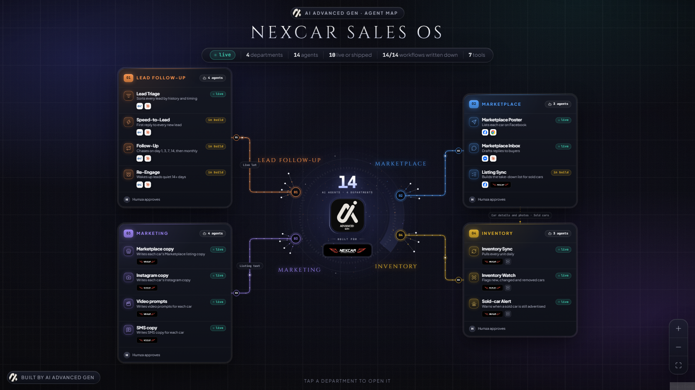
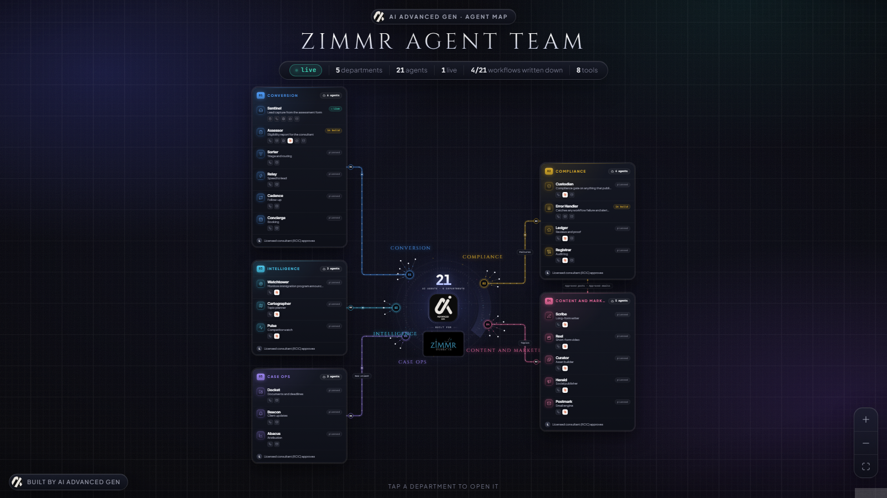

# Agent Map

An interactive map of an AI agent team: every department, every agent, the tools each one uses, and the step-by-step workflow each one runs. Built by [AI Advanced Gen](https://aiadvancedgen.com) to show clients, in one screen, what their AI system does and where a human approves.

**Live maps**

| System | What it is | Open |
|---|---|---|
| Nexcar Sales OS | 14 agents across lead follow-up, Marketplace, marketing and inventory for a car dealership's sales desk | `https://aiadvancedgen-source.github.io/Agent-Map/?client=nexcar` |
| ZIMMR Agent Team | A 21-agent design for an immigration consultancy, from assessment to marketing, with live, in-build and planned agents marked | `https://aiadvancedgen-source.github.io/Agent-Map/?client=zimmr` |





## How to read a map

- **The hub** in the middle is the client's system. Each coloured line runs to one department.
- **Tap a department** to zoom in and see its agents, the tools they touch, and who approves their work.
- **Tap an agent** to open its workflow: each step, when it runs, which tool it uses, example messages, and the decision a person makes at the end.
- **Badges** show the true state of each agent: `live`, `in build` or `planned`.
- **Dotted links** between departments show what one agent hands to another.

## How it works

Everything client-specific lives in one file, `clients/<name>/map.json`. Adding a client means adding that file and a logo; no code changes.

```
clients/<name>/map.json   departments, agents, tools, workflow steps, hand-offs
src/data/loadClient.ts    finds every client folder and logo at build time
src/layout/layout.ts      lays the map out automatically with ELK
src/components/           the canvas, department cards and the agent workflow panel
```

The shape of `map.json` is defined in [`src/types.ts`](src/types.ts).

## Stack

React 19, TypeScript, Vite, [React Flow](https://reactflow.dev) for the canvas, ELK for automatic layout, Motion for animation. Built with Claude Code.

## Run it locally

```bash
npm install
npm run dev
```

Then open the address it prints and add `?client=nexcar` or `?client=zimmr`.

## About the systems shown

- **Nexcar Sales OS** maps the system as it runs today.
- **ZIMMR Agent Team** maps the full designed team. The lead-capture agent is live, the eligibility-report agent and the error handler are in build, and the rest are planned. Scoring in that system is deterministic code; the model only writes a summary for the licensed consultant, and nothing reaches an applicant without consent on file.

The maps describe how each system works. Client data, credentials and the production workflows themselves are not in this repository.
