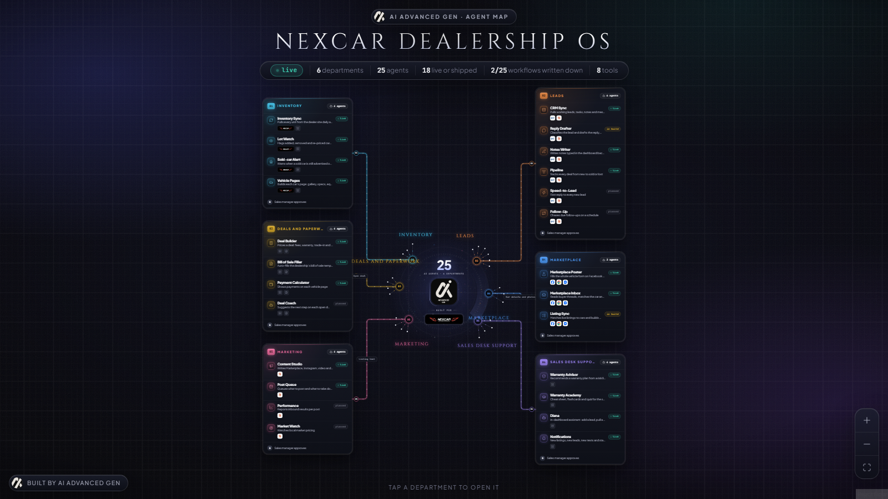
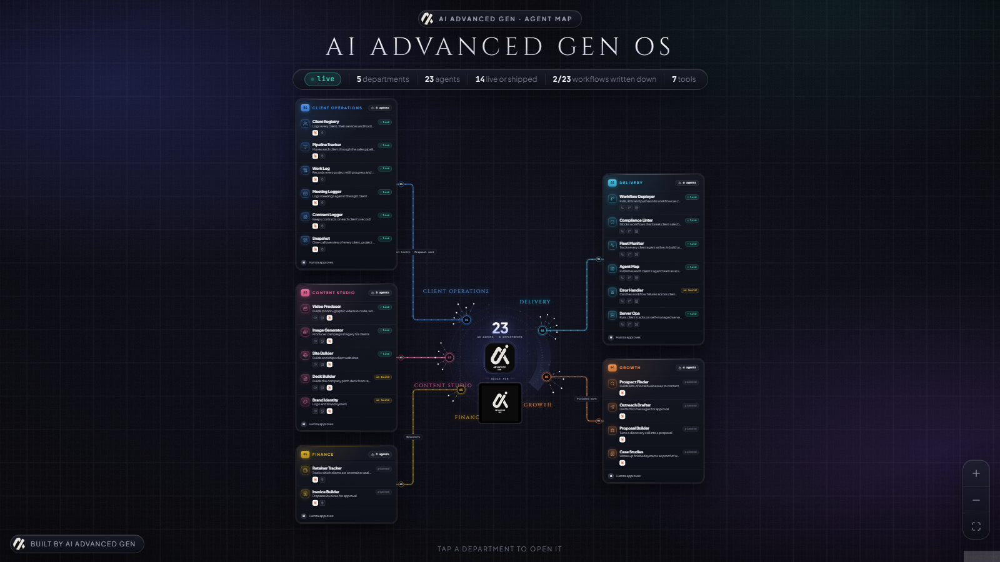
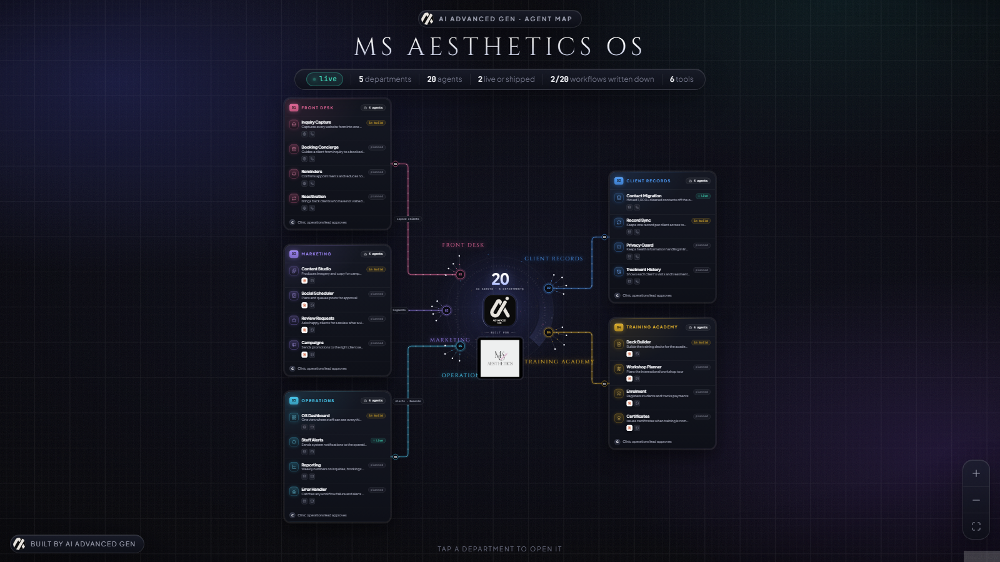
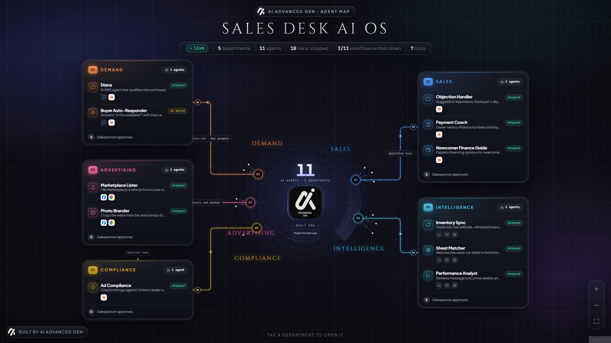

# Agent Map

An interactive map of an AI agent team: every department, every agent, the tools each one uses, and the step-by-step workflow each one runs. Built by [AI Advanced Gen](https://aiadvancedgen.com) to show clients, in one screen, what their AI system does and where a human approves.

## Live maps

| System | What it is | Open |
|---|---|---|
| Nexcar Sales OS | 14 agents for a car salesperson: lead follow-up, Marketplace, marketing and inventory | [open](https://aiadvancedgen-source.github.io/Agent-Map/?client=nexcar) |
| Nexcar Dealership OS | 25 agents for the dealership: inventory, leads, deals and paperwork, Marketplace, marketing and sales desk support | [open](https://aiadvancedgen-source.github.io/Agent-Map/?client=nexcar-dealership) |
| Maple Honda Sales Desk AI OS | 11 agents in five departments: demand, sales, advertising, intelligence and compliance | [open](https://aiadvancedgen-source.github.io/Agent-Map/?client=maple-honda) |
| ZIMMR Agent Team | 21 agents for an immigration consultancy, from assessment to marketing, built around compliance | [open](https://aiadvancedgen-source.github.io/Agent-Map/?client=zimmr) |
| MS Aesthetics OS | 20 agents for a med spa and training academy: front desk, client records, marketing, academy and operations | [open](https://aiadvancedgen-source.github.io/Agent-Map/?client=msaesthetics) |
| AI Advanced Gen OS | 23 agents that run the agency itself: client operations, delivery, content studio, growth and finance | [open](https://aiadvancedgen-source.github.io/Agent-Map/?client=aiadvancedgen) |

Every agent carries a badge that shows its true state: `live`, `shipped`, `in build` or `planned`.











## How to read a map

- **The hub** in the middle is the client's system. Each coloured line runs to one department.
- **Tap a department** to zoom in and see its agents, the tools they touch, and who approves their work.
- **Tap an agent** to open its workflow: each step, when it runs, which tool it uses, and the decision a person makes at the end.
- **Badges** show the state of each agent: `live`, `shipped`, `in build` or `planned`.
- **Dotted links** between departments show what one agent hands to another.

## How it works

Everything client-specific lives in one file, `clients/<name>/map.json`. Adding a client means adding that file and a logo; no code changes.

```
clients/<name>/map.json   departments, agents, tools, workflow steps, hand-offs
src/data/loadClient.ts    finds every client folder and logo at build time
src/layout/layout.ts      lays the map out automatically with ELK
src/components/           the canvas, department cards and the agent workflow panel
```

The shape of `map.json` is defined in [`src/types.ts`](src/types.ts).

## Stack

React 19, TypeScript, Vite, [React Flow](https://reactflow.dev) for the canvas, ELK for automatic layout, Motion for animation. Built with Claude Code.

## Run it locally

```bash
npm install
npm run dev
```

Then open the address it prints and add `?client=` followed by `nexcar`, `nexcar-dealership`, `maple-honda`, `zimmr`, `msaesthetics` or `aiadvancedgen`.

## About the systems shown

The maps describe how each system works and how far along each agent is. Agents marked `planned` are designed but not yet built. Client data, credentials and the production workflows themselves are not in this repository.
